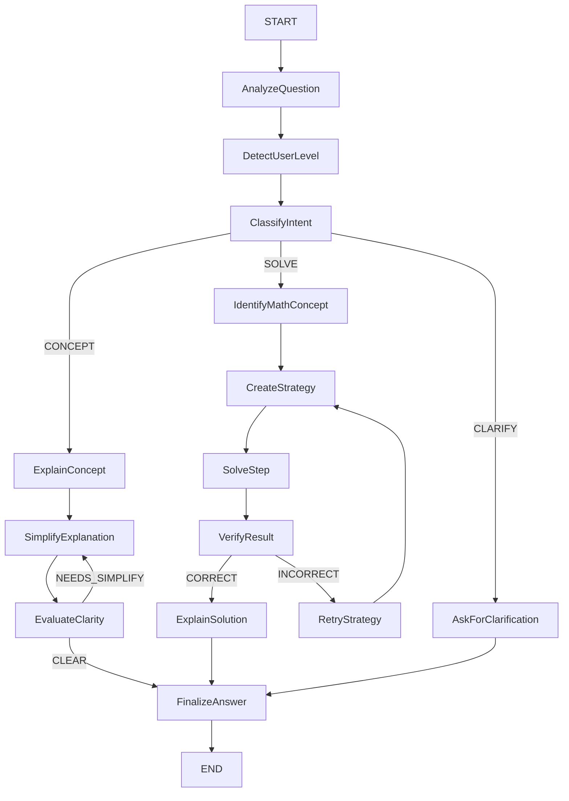

# Mylo Complex Mathematics Tutor

A terminal-based mathematics tutor built with LangGraph, LangChain, SymPy, and Python. The project models a real graph-based tutoring workflow where the agent analyzes the question, detects the user level, classifies the intent, and follows either a conceptual, solving, or clarification route.

## Overview

The tutor can:

- answer concept questions in English or Persian
- guide users through step-by-step solution workflows
- adapt explanation style to beginner, intermediate, or advanced learners
- verify symbolic results with SymPy when possible
- expose graph execution state in debug mode

## Installation

```bash
cd mylo-math-tutor
python3 -m venv .venv
source .venv/bin/activate
pip install -r requirements.txt
cp .env.example .env
```

## Environment setup

Fill in your OpenAI-compatible credentials in `.env`:

```env
OPENAI_API_KEY=your_key_here
OPENAI_MODEL=gpt-4o-mini
OPENAI_BASE_URL=
```

The base URL is optional when using the default OpenAI endpoint.

## Running the CLI

```bash
python cli.py
```

## Available commands

- `/help` — show command help
- `/level beginner` — set the tutoring level
- `/level intermediate` — set the tutoring level
- `/level advanced` — set the tutoring level
- `/debug on` — enable trace output for graph state and routing
- `/debug off` — disable trace output
- `/reset` — clear the current session state
- `/exit` — quit the tutor

## Graph architecture



## Node responsibilities

- `analyze_question`: detect missing information and language
- `detect_user_level`: use the selected CLI level or estimate a level from the question
- `classify_intent`: choose between concept, solve, or clarify
- `explain_concept`: draft a helpful conceptual explanation
- `simplify_explanation`: make the idea easier to understand
- `evaluate_clarity`: judge whether the language matches the learner level
- `identify_math_concept`: infer whether the task is algebra, calculus, geometry, probability, etc.
- `create_strategy`: build a structured solution path
- `solve_step`: execute one meaningful step at a time
- `verify_result`: check the answer with SymPy when possible
- `retry_strategy`: revise the approach if verification fails
- `explain_solution`: explain the solution in simple, level-appropriate language
- `ask_for_clarification`: request more details when the question is incomplete
- `finalize_answer`: format the final response for the CLI

## State schema

The shared graph state includes:

- `question`
- `user_level`
- `language`
- `intent`
- `math_concept`
- `strategy`
- `solution_steps`
- `current_step`
- `has_more_steps`
- `calculation_result`
- `verification_status`
- `explanation`
- `clarity_score`
- `retry_count`
- `max_retries`
- `errors`
- `final_answer`
- `current_node`
- `selected_branch`
- `debug_trace`

## Conditional branches

- concept questions branch to the explanatory workflow
- solving questions branch to the math strategy and verification workflow
- incomplete questions route to clarification
- clarity checks can loop back to simpler explanations until the retry limit is reached
- failed verification can trigger a retry strategy before finalizing

## Example questions

```text
What is a derivative?
Solve 2x + 5 = 15
انتگرال را خیلی ساده توضیح بده
```

## Testing

```bash
pytest -q
```

## Notes

This tutor is intentionally terminal-only and never executes arbitrary code from the user prompt. Symbolic verification is carried out through `sympy` with guarded parsing logic, and all LLM calls are optional.
