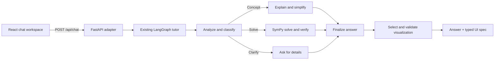

# Mylo Mathematics Tutor

Mylo is a mathematics tutor with a Python LangGraph core, a FastAPI adapter, and a responsive React/TypeScript learning workspace. The web experience calls the existing graph; the CLI remains available and uses the same graph.

## Architecture



- `agent.py` owns the graph, tutoring behavior, SymPy solution verification, and post-answer visualization selection.
- `visualizations.py` defines strict Pydantic schemas and an allowlisted expression validator. Generated output is data only; the frontend never executes model-produced code.
- `api.py` adapts the graph to FastAPI and keeps bounded, in-memory history per conversation ID for follow-up context. History is process-local, not durable, and resets when the API restarts.
- `frontend/` is a Vite, React, and TypeScript client. It renders backend visualization types with predefined components, Plotly, and JSXGraph.
- `cli.py` remains the terminal interface.

The graph keeps its existing concept, solve, and clarification routes. `select_visualization` runs after the finalized answer and returns a validated specification: `function_plot`, `derivative_plot`, `integral_plot`, `geometry`, `step_by_step`, `concept_card`, `parameter_explorer`, or `none`. Numeric arithmetic answers such as `What is 2 + 2?` do not receive an unnecessary chart.

The web request is `{ "message": "Explain derivatives", "level": "beginner", "conversationId": "optional-id" }`. The response contains `answer`, `conversationId`, `visualizations`, `steps`, and `metadata`. Conversation memory is limited to recent turns within the supplied conversation ID.

## Prerequisites

- Python 3.9 or newer
- Node.js 20 or newer and npm

## Installation

From the repository root:

```bash
python3 -m venv .venv
source .venv/bin/activate
pip install -r requirements.txt
cp .env.example .env
```

Install web client dependencies:

```bash
cd frontend
npm install
cd ..
```

## Environment

Set optional OpenAI-compatible credentials in `.env` to enable LLM explanations. Without a key, the graph uses local fallback answers and still solves supported equations with SymPy.

Offline mode includes direct SymPy arithmetic/equation solving, numerical root display with exact internal verification, and built-in explanations for common topics such as operations, fractions, primes, percentages, averages, slope, functions, probability, derivatives, and integrals. For arbitrary or less common conceptual questions, configure an OpenAI-compatible key; the local fallback intentionally does not claim to explain every possible topic.

```env
OPENAI_API_KEY=
OPENAI_MODEL=gpt-4o-mini
OPENAI_BASE_URL=
FRONTEND_ORIGINS=http://localhost:5173,http://127.0.0.1:5173
```

`FRONTEND_ORIGINS` is a comma-separated CORS allowlist. The API key stays on the Python backend and is never sent to the browser.

## Start the web application

Run the API from the repository root:

```bash
source .venv/bin/activate
uvicorn api:app --reload --host 127.0.0.1 --port 8000
```

In another terminal:

```bash
cd frontend
npm run dev
```

Open the URL Vite prints, normally `http://localhost:5173`. Vite proxies `/api` to port 8000. API health is at `http://127.0.0.1:8000/api/health`.

## Use the CLI

The original terminal tutor remains available:

```bash
source .venv/bin/activate
python cli.py
```

CLI commands: `/help`, `/level beginner|intermediate|advanced`, `/debug on`, `/debug off`, `/reset`, and `/exit`.

## Generative UI

The graph inspects the question, intent, explanation, solution steps, and verification state to select a visualization. Pydantic validates a closed union of supported types. Expression parsing allows only `x`, `a`, `b`, `c`, selected math functions, numeric literals, and arithmetic operators. Invalid or unsupported specs degrade to `none`.

- Function and derivative plots support pan, zoom, hover values, and an adjustable tangent point.
- Integral plots shade the selected interval.
- Parameter explorers recalculate plots from sliders.
- Geometry diagrams use JSXGraph; points can be dragged and circle radius can be adjusted.
- Solved equations render expandable steps and verification status.
- Concept cards render explanations and optional KaTeX formulas.
- Persian assistant messages use RTL text layout while formulas keep normal math direction.

## Tests and checks

Python agent, API, and visualization tests:

```bash
source .venv/bin/activate
pytest -q
```

Frontend component and chat tests, lint, and production build:

```bash
cd frontend
npm run test
npm run lint
npm run build
```
