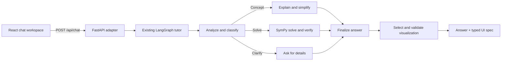

# Mylo Mathematics Tutor

Mylo is a mathematics tutor with a Python LangGraph core, a FastAPI adapter, and a responsive React/TypeScript learning workspace. The web experience calls the existing graph; the CLI remains available and uses the same graph.

## Architecture



- `agent.py` owns the graph, tutoring behavior, SymPy solution verification, and post-answer visualization selection.
- `visualizations.py` defines strict Pydantic schemas and an allowlisted expression validator. Generated output is data only; the frontend never executes model-produced code.
- `api.py` adapts the graph to FastAPI and stores conversations in a local SQLite database, including full answers and visualization specifications. Recent turns are supplied to the tutor for follow-up context.
- `frontend/` is a Vite, React, and TypeScript client. It renders backend visualization types with predefined components, Plotly, and JSXGraph.
- `cli.py` remains the terminal interface.

The graph keeps its existing concept, solve, and clarification routes. `select_visualization` runs after the finalized answer and returns a validated specification: `function_plot`, `derivative_plot`, `integral_plot`, `geometry`, `step_by_step`, `concept_card`, `parameter_explorer`, or `none`. Numeric arithmetic answers such as `What is 2 + 2?` do not receive an unnecessary chart.

The web request is `{ "message": "Explain derivatives", "level": "beginner", "conversationId": "optional-id" }`. The response contains `answer`, `conversationId`, `visualizations`, `steps`, and `metadata`. Model context is limited to recent turns within the supplied conversation ID, while the full transcript remains saved. Saved chats are available through `GET /api/conversations` and `GET /api/conversations/{id}`.

## Prerequisites

- Python 3.9 or newer
- Node.js 20 or newer and npm

## Installation

From the repository root:

```bash
python3 -m venv .venv
source .venv/bin/activate
pip install -r requirements.txt
cp .env.example .env
```

Install web client dependencies:

```bash
cd frontend
npm install
cd ..
```

## Environment

The default provider is local Ollama. No OpenAI key is needed. Install Ollama, start its server, and download the configured model:

```bash
ollama serve
# In another terminal:
ollama pull qwen3:4b
```

Configure `.env` (or export these variables). The application also uses these defaults if they are omitted:

```ini
LLM_PROVIDER=ollama
OLLAMA_BASE_URL=http://localhost:11434
OLLAMA_MODEL=qwen3:4b
```

The shared `llm_factory.py` uses LangChain `ChatOllama`, checks the server's `/api/tags` model list, and reports actionable errors for a missing server or model. Chat messages and CLI output show Ollama, OpenAI, or offline fallback. `GET /api/health` returns provider availability; chat response metadata also reports whether inference was used. If inference fails, supported SymPy computations and built-in examples remain available. Local inference may take longer on the first request while the model loads; the connection/read timeout is 120 seconds, while total streamed generation may take longer.

OpenAI remains optional: select `LLM_PROVIDER=openai` and set `OPENAI_API_KEY`, with optional `OPENAI_MODEL` and `OPENAI_BASE_URL`. Select `LLM_PROVIDER=offline` for deterministic local math without inference.

All 25 formula presets include complete offline worked examples. General explanations use the selected model. Concrete equations are solved and checked with SymPy. Indefinite integrals such as `∫ 5x² dx` are checked by differentiating the antiderivative; concrete derivatives are checked against the limit definition. `5x² = 676` is treated as an equation, not an integral. Include the integral sign and differential to request integration. Unsupported calculus notation is not marked as verified. Model prose is explanatory and is not itself certified by SymPy.

The LangGraph nodes, edges, retry limits, and recent conversation memory remain in place. API and CLI conversations are saved locally in `data/chat_history.sqlite3` (override with `CHAT_HISTORY_DB`). The sidebar lists saved chats and the browser restores the last open conversation after refresh. Starting a new chat does not delete saved chats. In the CLI, use `/history` to list saved conversations and `/load <id>` to reopen one; `/reset` starts a new session without deleting history. The existing React components render only validated visualization specs, never model-generated executable code.

`FRONTEND_ORIGINS` is a comma-separated CORS allowlist. The API key stays on the Python backend and is never sent to the browser.

## Start the web application

Run the API from the repository root:

```bash
source .venv/bin/activate
uvicorn api:app --reload --host 127.0.0.1 --port 8000
```

In another terminal:

```bash
cd frontend
npm run dev
```

Open the URL Vite prints, normally `http://localhost:5173`. Vite proxies `/api` to port 8000. API health is at `http://127.0.0.1:8000/api/health`.

## Use the CLI

The original terminal tutor remains available:

```bash
source .venv/bin/activate
python cli.py
```

CLI commands: `/help`, `/level beginner|intermediate|advanced`, `/debug on`, `/debug off`, `/reset`, `/history`, `/load <id>`, and `/exit`.

Explanation levels change the teaching style while keeping computed results and checks the same. Beginner explains each operation and symbol; intermediate focuses on the method and essential steps; advanced uses formal reasoning with domains and exceptional cases. The same policies apply to model prompts and supported offline explanations. Changing the selected level automatically regenerates the latest answer in place, preserving the question, conversation ID, and any unsent draft. Earlier questions stay unchanged. Each answer reports its level in `metadata.explanationLevel` and shows a level badge in the UI.

## Generative UI

The graph inspects the question, intent, explanation, solution steps, and verification state to select a visualization. Pydantic validates a closed union of supported types. Expression parsing allows only `x`, `a`, `b`, `c`, selected math functions, numeric literals, and arithmetic operators. Invalid or unsupported specs degrade to `none`.

- Function and derivative plots support pan, zoom, hover values, and an adjustable tangent point.
- Integral plots shade the selected interval.
- Parameter explorers recalculate plots from sliders.
- Geometry diagrams use JSXGraph; points can be dragged and circle radius can be adjusted.
- Solved equations render expandable steps and verification status.
- Concept cards render explanations and optional KaTeX formulas.
- Persian assistant messages use RTL text layout while formulas keep normal math direction.

## Tests and checks

Python agent, API, and visualization tests:

```bash
source .venv/bin/activate
pytest -q
```

Frontend component and chat tests, lint, and production build:

```bash
cd frontend
npm run test
npm run lint
npm run build
```
